# Propuesta para Only Cards

**Para:** el equipo de Only Cards (Vigo)
**Asunto:** convertir only-cards.com en una tienda que venda sola

---

## En una frase

Only Cards tiene buen producto, buenos precios y una tienda en Vigo, pero la web no lo cuenta. Proponemos
un paquete de mejoras que **ya funciona sobre vuestra web actual** (lo hemos probado) y se instala en
10 minutos, sin cambiar de plataforma ni tocar los pedidos.

## Lo que hemos visto

- Un **enlace roto** en el pie: «Condiciones generales de venta» da error 404.
- El **filtro de precio muestra importes sin IVA**: 6,61 €–190,08 € en lugar de 8 €–230 €.
- **No hay portada ni categorías.** Un cliente que llega desde Instagram ve una lista de 18 productos sin contexto.
- **La tienda de Vigo es invisible**, aunque la recogida en tienda ya está configurada en Odoo.
- **7 de 18 productos agotados** (39 %), y no hay forma rápida de pedir aviso por WhatsApp.
- **Las preventas no destacan.** Magnificent Maestros sale el 12 de noviembre y no hay cuenta atrás ni insignia.
- **SEO:** sin `meta description`, datos de producto mínimos y ningún dato de tienda local para Google.

El detalle completo está en [AUDITORIA.md](AUDITORIA.md).

## Lo que os entregamos

### 1. Only Cards Booster: listo hoy

Un script que se pega en Odoo (*Inyección de código*) y añade:

- Barra superior con envío, garantía, devoluciones, recogida en Vigo y WhatsApp.
- Cabecera de marca encima del catálogo.
- **Filtros por juego y por idioma** con un clic (Pokémon · Yu-Gi-Oh! · Riftbound · ES · EN · Solo disponibles).
- Insignias de **idioma** y **preventa** con fecha.
- **Precio por sobre** en cajas y blísteres (5,56 €/sobre en Dominio Delta).
- **«Avísame por WhatsApp»** en los productos agotados.
- **Cuenta atrás** en las preventas.
- Bloque de confianza junto al botón de compra.
- **Barra de compra fija en móvil.**
- Vistos recientemente y botón flotante de WhatsApp.
- **SEO:** fichas enriquecidas para Google (precio, stock, preventa, marca, idioma), migas de pan,
  ficha de tienda local en Vigo con horario, y descripciones para buscadores.
- Arregla el enlace roto y la errata «Grantía».

**Antes y después** (capturas reales de vuestra web, en `capturas/`):

| Página | Antes | Después |
|--------|-------|---------|
| Tienda (escritorio) | 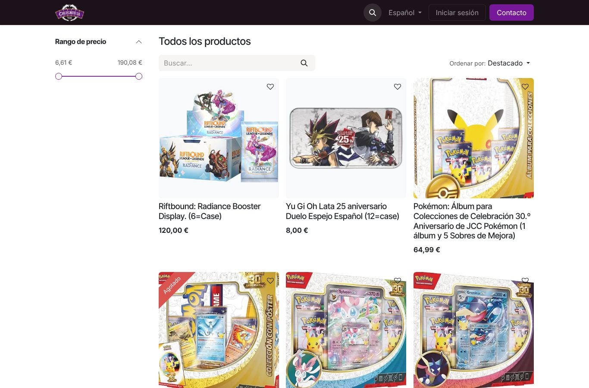 | 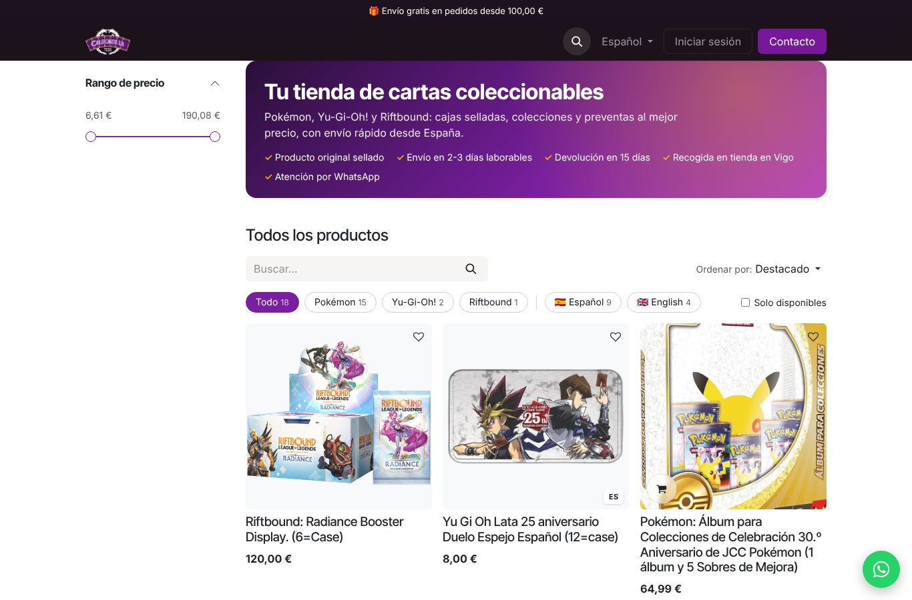 |
| Tienda (móvil) | 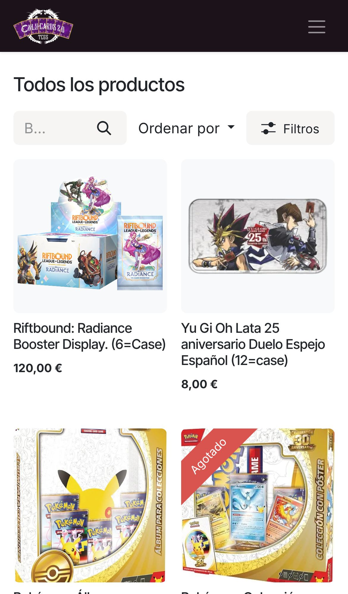 | 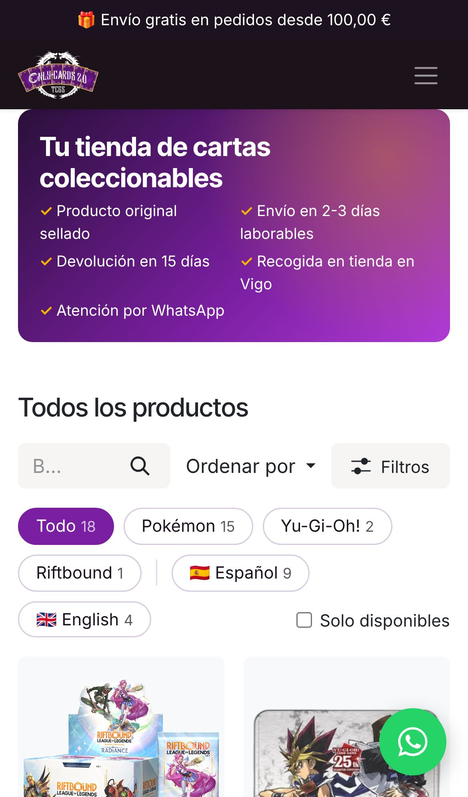 |
| Ficha | 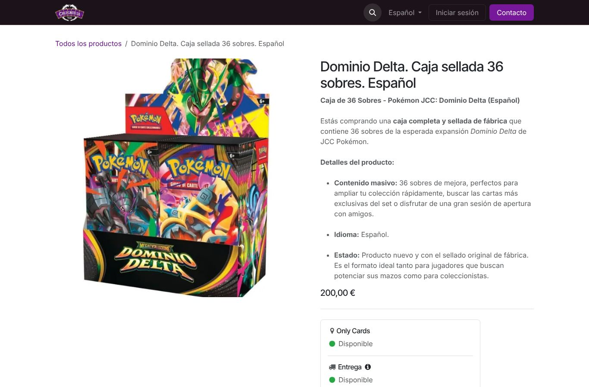 | 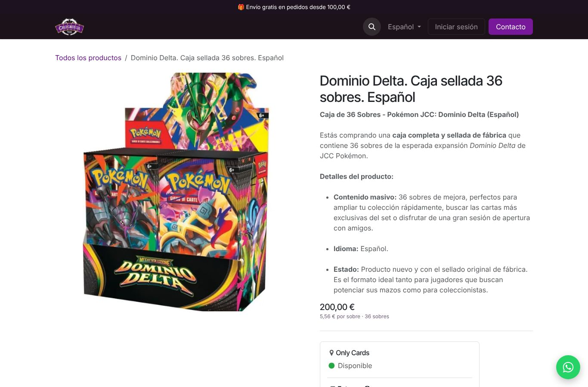 |
| Preventa | 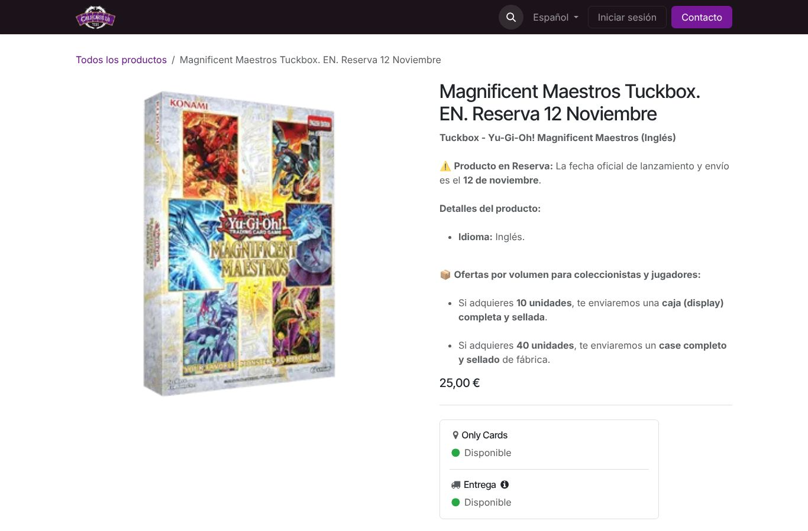 | 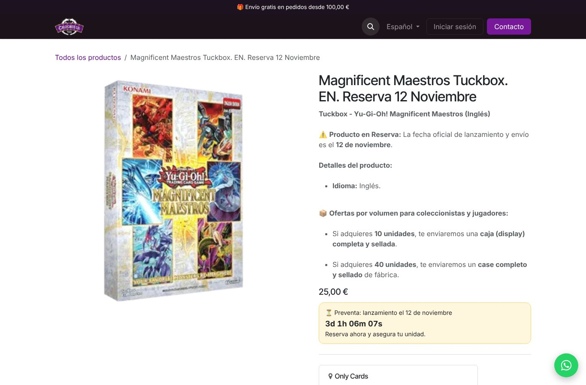 |
| Agotado | 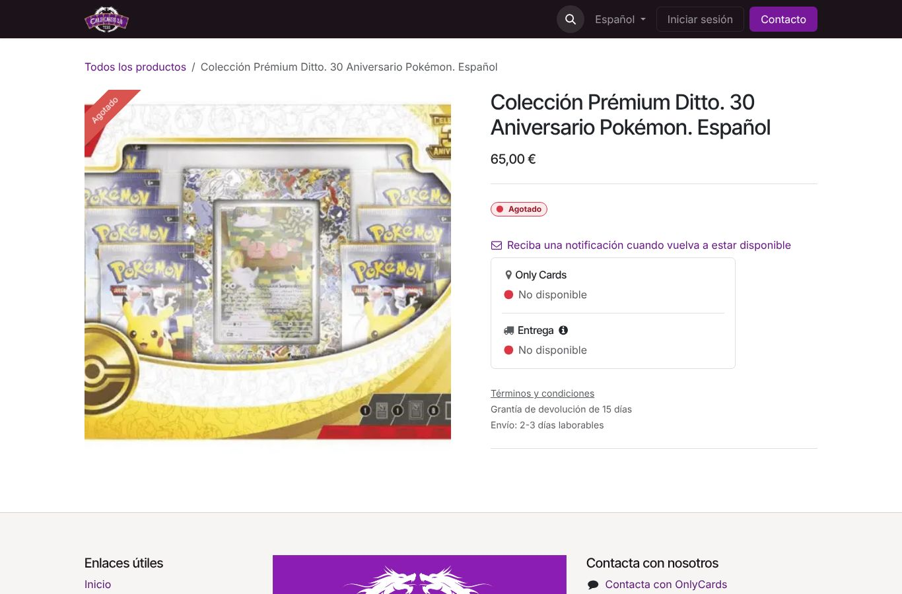 | 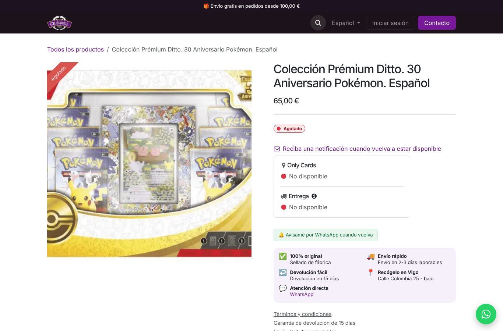 |
| Móvil, scroll en ficha | — | 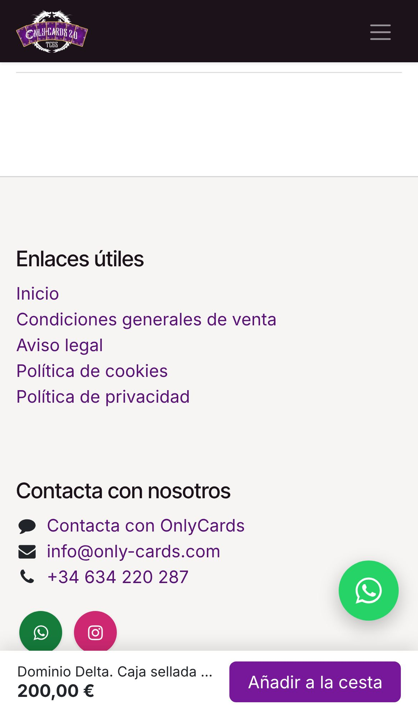 |

### 2. Fotos de producto re-encuadradas: listas hoy

Las 18 fotos actuales tienen tamaños de 300 a 1024 px, proporciones distintas, márgenes desiguales y fondos de
colores diferentes. Como el listado de Odoo recorta en cuadrado, algunas salen cortadas (el álbum o la colección
con póster). Las hemos re-encuadrado todas con el mismo criterio: producto completo y centrado, mismo tamaño,
fondo blanco y sombra suave. Solo hay que subirlas.

| Listado actual | Con las fotos nuevas |
|----------------|----------------------|
| 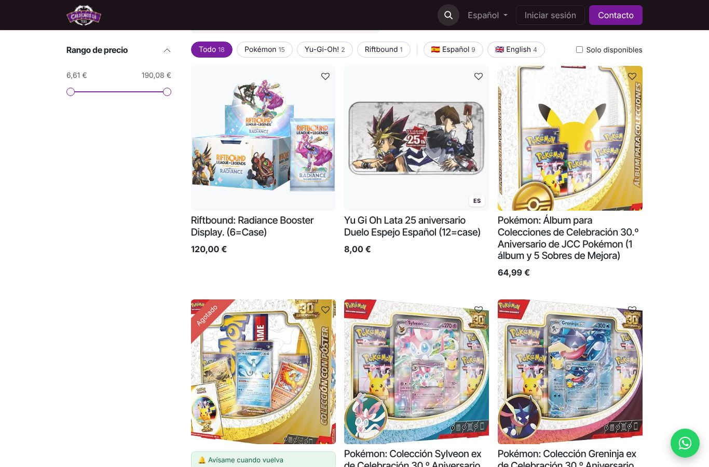 | 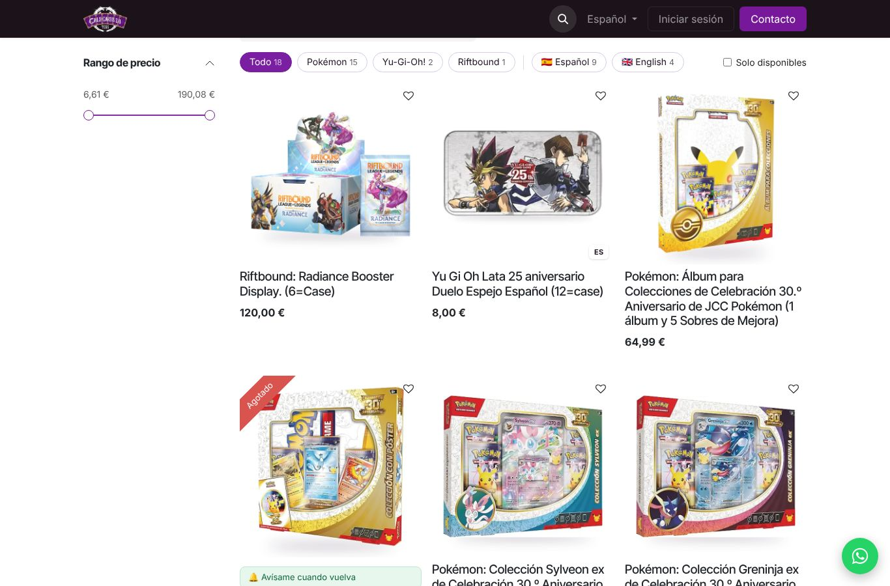 |

Todas, una a una: [imagenes/comparativa.jpg](imagenes/comparativa.jpg).

### 3. Puesta a punto en Odoo

Lo que debe arreglarse en la propia plataforma: corregir el enlace y el IVA del filtro, crear categorías
y el atributo de idioma, hacer una portada real con novedades, preventas y la tienda de Vigo, normalizar
los nombres de producto y redactar descripciones SEO.

### 4. Crecimiento

Google Business Profile de la tienda de Vigo, Google Shopping (Merchant Center), newsletter con cupón de
bienvenida para avisar de las preventas, y un informe mensual de GA4 (visitas, carritos y ventas por juego).

## Paquetes

Precios orientativos, para ajustar en la reunión.

| Paquete | Incluye | Precio |
|---------|---------|--------|
| **Booster** | Instalación y configuración del script, subida de las fotos re-encuadradas, revisión con vosotros, 30 días de ajustes | 390 € |
| **Booster + Odoo** | Lo anterior y la puesta a punto completa en Odoo (puntos 2 y 3) | 990 € |
| **Crecimiento** | Mantenimiento del script, alta de productos con SEO, Merchant Center e informe mensual | 79 €/mes |

## Cómo medimos el resultado

Con el GA4 que ya tenéis, comparando 30 días antes y 30 días después:

- Tasa de conversión (visitas → pedidos) y porcentaje de visitas que añaden algo al carrito.
- Clics en WhatsApp (consultas y avisos de agotados).
- Impresiones y clics en Google (Search Console), y si aparecen resultados enriquecidos con precio y stock.
- Pedidos con recogida en Vigo.

## Siguiente paso

Una llamada de 20 minutos para enseñaros la vista previa en directo sobre vuestra web. No hace falta
instalar nada antes.
